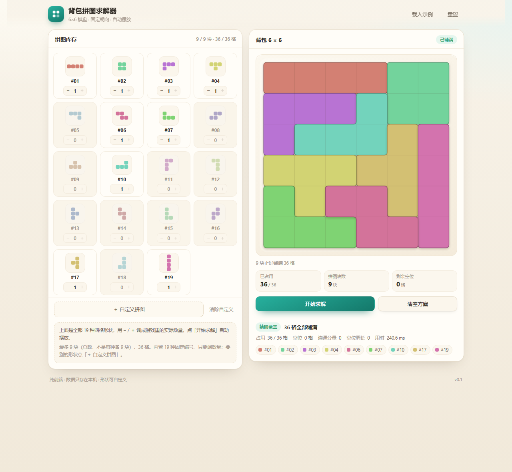

# 背包拼图求解器

《疯狂水世界》6×6 行李箱背包的拼图摆放求解器。纯前端、无需构建，双击 `index.html` 就能用。

**在线使用：<https://helandou233.github.io/bag-puzzle-solver/>**（手机浏览器直接打开也可以）



## 功能

- **19 种形状全覆盖**：4 格上下左右连通、固定朝向的形状正好 19 种，编号 `#01`–`#19`，旋转/镜像算不同种类。
- **总量上限 9 块**：9 块 × 4 格 = 36 格，正好是一整块棋盘；达到 9 块后加号自动禁用。
- **一键求解**：优先找精确铺满（36/36）；铺不满时给出「占用格最多 → 空位最连通 → 空位周长最短」的方案。
- **未放下的拼图有明确提示**：棋盘红色状态标签、结果区红色提示块、库存磁贴红色角标，并可一键把没放下的块减掉重新求解。
- **补位建议**：剩余空位还能塞进哪些形状，标出「正好补满」的选项。
- **自定义形状**：5×5 网格 + 7 种预设骨牌，可改名字和颜色；内置 19 种固定编号不可删改。
- **手机适配**：窄屏单栏 + 底部固定操作栏。
- **本地存档**：库存自动存在 `localStorage`，刷新不丢。

## 使用

- 在线：<https://helandou233.github.io/bag-puzzle-solver/>
- 本地：双击打开 `index.html`（`file://` 可用，无需服务器；记得连同 `assets/` 目录一起）

操作流程：按游戏里的实际库存调数量 → 点「开始求解」→ 看右侧棋盘与结果；没铺满时看补位建议，有拼图没放下时点红色提示里的「减掉这 N 块再摆」。

## 目录

```
index.html              页面结构
assets/
  pieces.js             19 种形状、配色、路径生成
  solver.js             摆放求解器（纯函数，可单独在 Node 里跑）
  app.js                渲染与交互
  style.css             样式
tests/tile-check.py     形状完整性与示例组合校验
tools/make-gallery.py   生成 19-shapes.png 总览图
19-shapes.png           19 种形状总览
```

## 求解规则

- 棋盘 6×6，`index = r * 6 + c`。
- 每块恰好 4 格、上下左右四连通；**朝向固定**，不旋转、不翻转（与游戏内一致）。
- 单块可放多份，总块数 ≤ 9、总格数 ≤ 36。
- 评分按字典序：已占格数↑ → 空位连通分量↓ → 空位周长↓。
- 搜索：先贪心求下界，再跑可重启 DFS（随机化候选顺序但固定随机种子，结果可复现），单次上限 900ms / 800 万结点；找到满覆盖立即结束。

## 校验

```bash
python tests/tile-check.py     # 19 种形状无缺漏 + 示例组合可精确铺满 6x6
python tools/make-gallery.py   # 重新生成 19-shapes.png
```

求解器本身不碰 DOM，也可以直接在 Node 里调用（两个脚本会把 `PZ` 挂到 `globalThis`）：

```js
require('./assets/pieces.js');
require('./assets/solver.js');
const PZ = globalThis.PZ;
const res = PZ.solve({ rows: 6, cols: 6, pieces, registry, timeoutMs: 900 });
```
